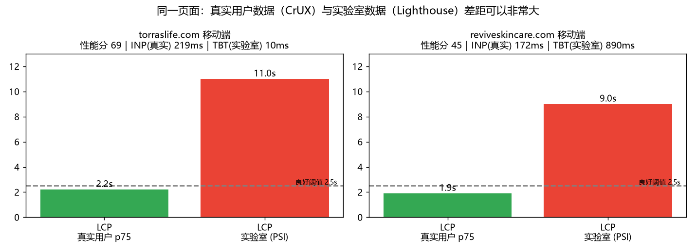

# Shopify 站点性能优化实战教程：从 PageSpeed 报告到可落地的修复

这是一套**以真实店铺为案例**的 Shopify 性能优化教程。目标不是“把分数刷到 100”，而是教会你：

1. 看懂 PageSpeed Insights（下文简称 PSI）报告里每一块数据的含义和可信度；
2. 从一个“红色指标”一路追到具体的 **Liquid 模板 / 图片 / CSS / App / 第三方脚本**；
3. 在 Shopify 主题里用正确的方式修复，并用正确的方式复测和长期监控。

教程使用两个真实的 Shopify 站点做拆解（均为公开页面、只读分析，未对站点做任何修改）：

| 站点 | 主题 | PSI 移动端性能分 | 真实用户 Core Web Vitals（移动端） |
| --- | --- | --- | --- |
| [torraslife.com](https://torraslife.com/) | Woodstock 1.3.0（深度定制） | **69** | **未通过**（INP 219 ms） |
| [reviveskincare.com](https://reviveskincare.com/) | Impulse 7.6.0 | **45** | **通过**（LCP 1.9 s / INP 172 ms / CLS 0） |

> 这张表本身就是第一课：**分数低的站点真实用户体验反而通过了，分数高的反而没通过。** 原因见 [第 1 章](docs/01-pagespeed-basics.md)。



## 网页版：指标优化教程

[`web/metrics-guide.html`](web/metrics-guide.html) 是一个可离线打开的单页网页（下载后双击即可）：按 LCP、INP、CLS、FCP、TTFB、TBT、SI 逐项讲解怎么看、常见原因、Shopify 修复方法，并附 24 篇精选外部教程。源文件为 `web/metrics-guide.body.html`。

## 目录

| 章节 | 你会学到 |
| --- | --- |
| [01. 读懂 PageSpeed Insights](docs/01-pagespeed-basics.md) | 报告结构、Field vs Lab、Core Web Vitals 阈值、分数怎么算、为什么每次分数不一样 |
| [02. 诊断方法论：从指标到根因](docs/02-diagnosis-workflow.md) | 一套固定的排查顺序；每个 Insight/Diagnostic 在 Shopify 里通常对应什么问题 |
| [03. 案例一：torraslife.com](docs/03-case-torraslife.md) | 4.9 MB 的 HTML、被稀释的 fetchpriority、INP 不达标的根因与修复方案 |
| [04. 案例二：reviveskincare.com](docs/04-case-reviveskincare.md) | 首屏视频、5.8 s 的 JS 执行、渲染阻塞 CSS、第三方弹窗图片 |
| [05. Shopify 修复手册（代码）](docs/05-shopify-fix-playbook.md) | 可直接复制的 Liquid/JS 代码：首屏图、响应式图、视频、App 脚本延迟、CSS、字体、INP |
| [06. 复测、监控与检查清单](docs/06-retest-and-monitoring.md) | 如何做可信的前后对比、CrUX/RUM 监控、上线前检查清单 |

## 测试快照说明（重要）

性能数据是**某一时刻的快照**，不是站点的永久属性。本教程中的数据来源：

| 数据 | 采集方式 | 时间（UTC） |
| --- | --- | --- |
| PSI 报告（截图来源） | [pagespeed.web.dev](https://pagespeed.web.dev/)，Lighthouse 13.6.0，移动端 = 模拟 Moto G Power + Slow 4G，桌面端 = Custom throttling | 2026-11-09 11:53（TORRAS）/ 12:01（ReVive） |
| 真实用户数据 | PSI 顶部的 Chrome UX Report（CrUX），近 28 天、第 75 百分位 | 同上 |
| 本地 Lighthouse JSON | 本机 Chrome + Lighthouse CLI 12.8.2，用于提取第三方/资源类型等明细（数值与 PSI 不同，原因见第 1 章） | 2026-11-09 |
| HTML 结构统计 | 直接下载首页 HTML 后用 [scripts/analyze-shopify-html.py](scripts/analyze-shopify-html.py) 统计 | 2026-11-09 |

原始报告链接（PSI 报告会过期，过期后请重新测试）：

- TORRAS：<https://pagespeed.web.dev/analysis/https-torraslife-com/8vnxxui4n0?form_factor=mobile>
- ReVive：<https://pagespeed.web.dev/analysis/https-reviveskincare-com/tk5735ers9?form_factor=mobile>

## 仓库结构

```
.
├── README.md
├── docs/                      # 教程正文（01 ~ 06）
├── images/
│   ├── charts/                # 根据测试数据绘制的图表
│   ├── torras/                # torraslife.com 的 PSI 截图
│   └── revive/                # reviveskincare.com 的 PSI 截图
└── scripts/
    ├── lighthouse-summary.py      # 从 Lighthouse JSON 提取关键诊断
    └── analyze-shopify-html.py    # 统计 Shopify 页面 HTML 的“体积账单”
```

## 一句话总结两个案例

- **TORRAS**：问题不在“某个大文件”，而在 **HTML 本身**——一个表单 App 往每个页面的 `<head>` 内联了约 2 MB 的配置，购物车抽屉/菜单/分类 section 再贡献数 MB 标记，6,744 个 DOM 节点，另有 8 个元素同时声明了 `fetchpriority="high"`。这让 LCP 图片被发现得晚、交互时渲染成本高（INP 不达标）。
- **ReVive**：首屏 HTML 很健康，问题在 **首屏之后的一切**——移动端首屏是一个 1080p/4.8 Mbps 的视频（约 2.9 MB），加上 Sentry、Firework、Kaltura、Accessibe、Forter、Attentive 等脚本带来 5.8 s 的 JS 执行时间和 890 ms 的 TBT，以及 4 个渲染阻塞 CSS。
