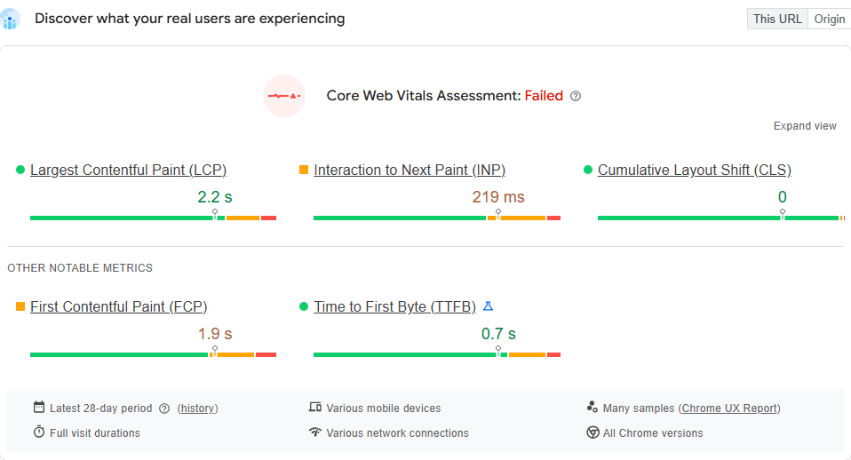
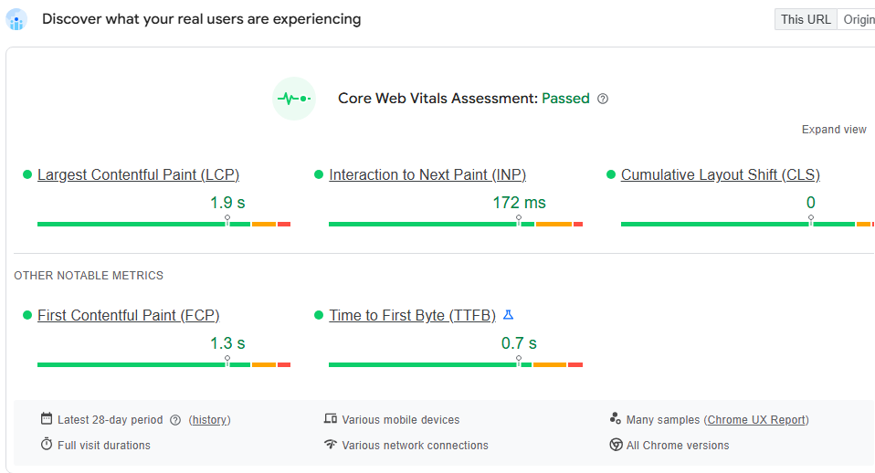
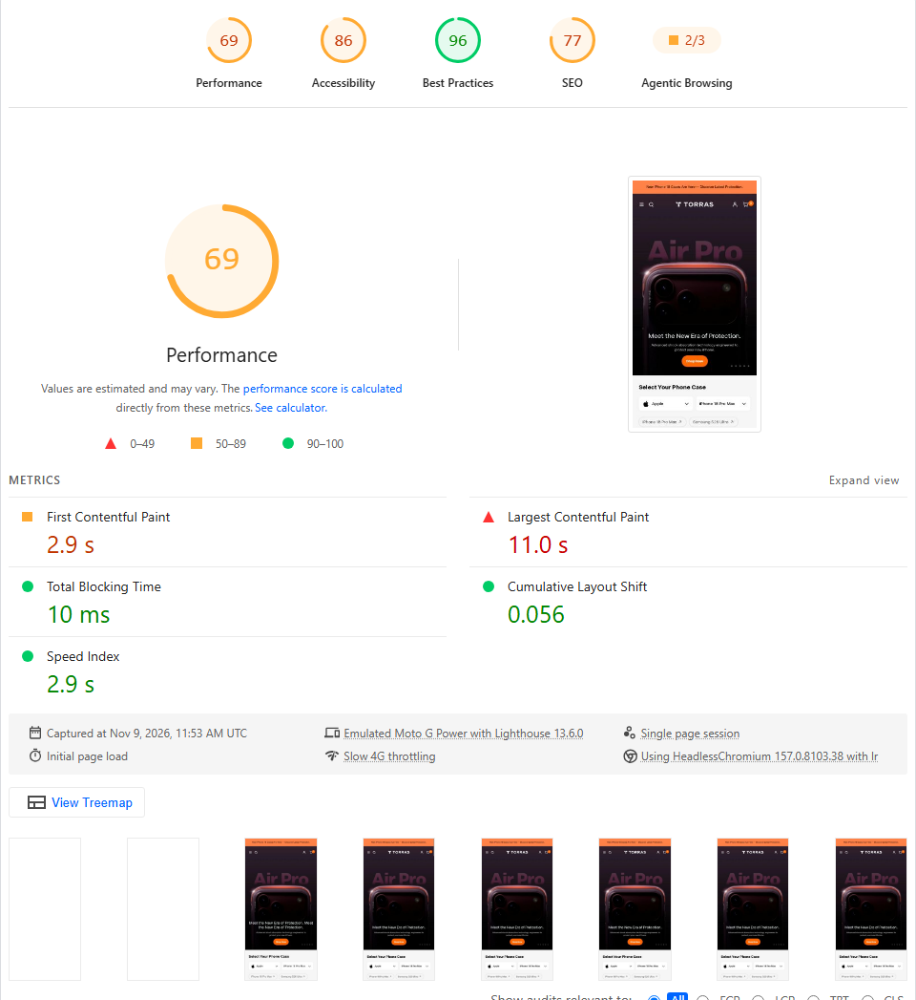
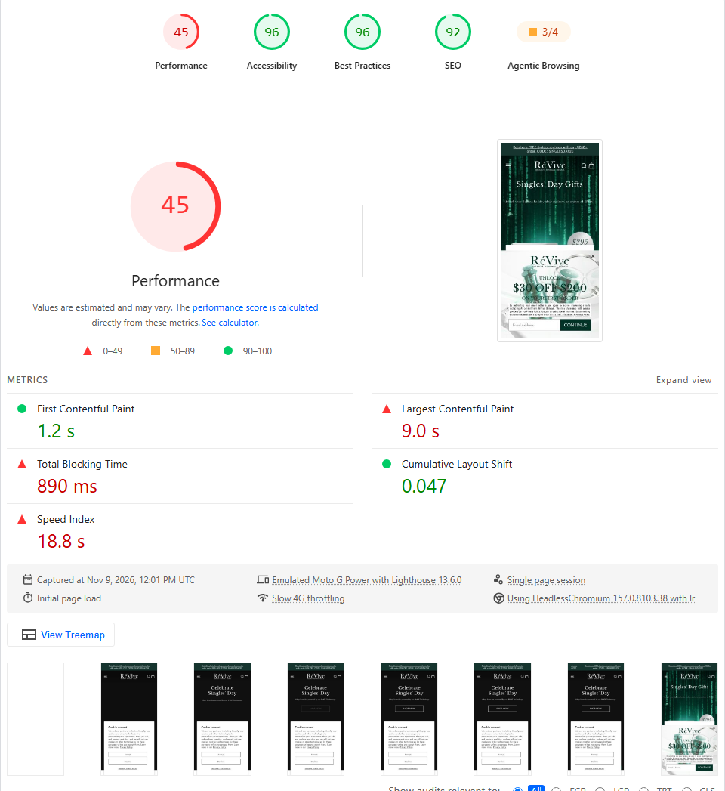
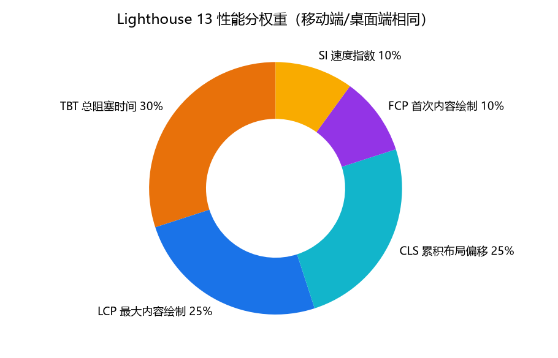
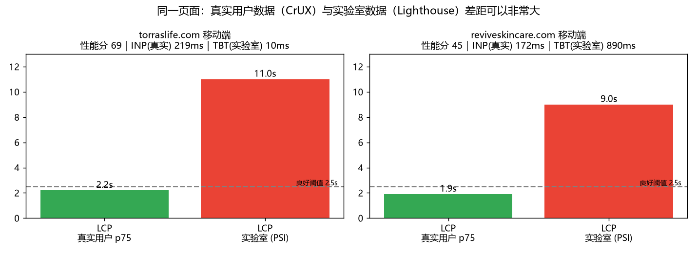
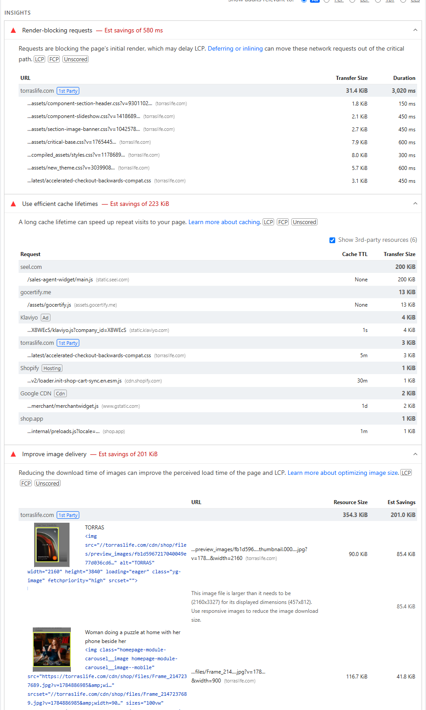

# 01. 读懂 PageSpeed Insights

> 上一章：[README](../README.md) ｜ 下一章：[02. 诊断方法论](02-diagnosis-workflow.md)

很多人打开 PSI 只看那个圆圈分数，然后去“消灭红色条目”。这是最常见、也最浪费时间的用法。本章先把报告拆开，讲清楚**每一块数据是什么、可信度如何、应该用来做什么决定**。

## 1.1 报告的三大块

打开 <https://pagespeed.web.dev/>，输入网址后，报告从上到下分为：

| 区块 | 标题 | 数据来源 | 用途 |
| --- | --- | --- | --- |
| ① 真实用户数据 | *Discover what your real users are experiencing* | Chrome UX Report（CrUX），真实 Chrome 用户近 28 天数据 | **判断“到底有没有问题”**，Google 搜索的页面体验信号也用这份数据 |
| ② 实验室数据 | *Diagnose performance issues*（分数 + 5 个指标） | 一次 Lighthouse 模拟测试 | **复现和定位问题**，分数只代表这一次模拟 |
| ③ 诊断项 | *Insights* / *Diagnostics* / *Passed audits* | 同一次 Lighthouse 的明细 | **找到具体资源和代码位置** |

页面顶部有 **Mobile / Desktop** 两个标签，分别是两次独立的测试。Shopify 店铺的流量大多来自手机，**优先看 Mobile**。

### ① 真实用户数据（Field data）

*图：torraslife.com 移动端 CrUX 数据。LCP 2.2 s、CLS 0 是绿色，但 INP 219 ms 是橙色，所以整体 **Core Web Vitals Assessment: Failed**。*

*图：reviveskincare.com 移动端 CrUX 数据，三项全部绿色，**Passed**。*

阅读要点：

- 每个指标显示的是**第 75 百分位（p75）**：75% 的访问比这个值更好。
- **LCP、INP、CLS** 三项全部“良好”才算通过；任何一项不达标就是 Failed。FCP、TTFB 只是参考，不参与判定。
- 右上角 **This URL / Origin** 切换：URL 数据只统计这个网址，Origin 统计整个域名。新页面或流量小的页面可能没有 URL 级数据，只能看 Origin。
- 点 *Expand view* 可以看到每个指标“良好 / 需改进 / 差”三段的访问占比，比单个 p75 更能体现分布。
- 这是 **28 天滚动窗口**：今天上线的优化，要过几天到 4 周才会完整体现在这里。

### ② 实验室数据（Lab data）与性能分

*图：torraslife.com 移动端 Lighthouse 结果：性能分 69，FCP 2.9 s，LCP 11.0 s（红），TBT 10 ms（绿），CLS 0.056，SI 2.9 s。报告底部写明了测试环境：Emulated Moto G Power、Slow 4G throttling、Lighthouse 13.6.0。*

*图：reviveskincare.com 移动端：性能分 45，FCP 1.2 s，LCP 9.0 s，TBT 890 ms，CLS 0.047，Speed Index 18.8 s。*

## 1.2 Core Web Vitals 与其它指标

| 指标 | 衡量什么 | 良好 | 需改进 | 差 | 出现在 |
| --- | --- | --- | --- | --- | --- |
| **LCP** Largest Contentful Paint | 视口内最大的图片/文字块渲染完成的时间（“主内容出来了吗”） | ≤ 2.5 s | ≤ 4 s | > 4 s | Field + Lab |
| **INP** Interaction to Next Paint | 用户点击/按键后到下一帧画面的延迟，基本取整个访问中最慢的那次交互（“点了有反应吗”） | ≤ 200 ms | ≤ 500 ms | > 500 ms | **仅 Field** |
| **CLS** Cumulative Layout Shift | 页面元素意外移动的程度（“页面会跳吗”） | ≤ 0.1 | ≤ 0.25 | > 0.25 | Field + Lab |
| FCP First Contentful Paint | 第一个文字/图片出现 | ≤ 1.8 s | ≤ 3 s | > 3 s | Field + Lab |
| TTFB Time to First Byte | 服务器返回 HTML 第一个字节 | ≤ 0.8 s | ≤ 1.8 s | > 1.8 s | Field |
| TBT Total Blocking Time | FCP 之后主线程被长任务（>50 ms）阻塞的总时长 | ≤ 200 ms | ≤ 600 ms | > 600 ms | **仅 Lab**（INP 的实验室代理指标） |
| SI Speed Index | 页面可见内容填充的速度 | ≤ 3.4 s | ≤ 5.8 s | > 5.8 s | 仅 Lab |

> 关键点：**实验室里没有 INP**，因为 Lighthouse 不会去点击页面，它用 TBT 近似反映“主线程忙不忙”。但 TBT 只统计**页面加载阶段**，而 INP 统计**整个访问过程中的交互**。TORRAS 就是典型：实验室 TBT 只有 10 ms，真实用户 INP 却是 219 ms——问题更可能出在交互发生时（打开菜单、切换轮播、加购、打开购物车抽屉）的脚本和渲染成本，而不是加载阶段。详见 [第 3 章](03-case-torraslife.md)。

## 1.3 性能分是怎么算出来的

Lighthouse 把 5 个实验室指标各自换算成 0–100 分，再加权：**TBT 30%、LCP 25%、CLS 25%、FCP 10%、SI 10%**。点开报告里的 *See calculator* 可以看到每个指标贡献了多少分。

PSI 页面上，指标筛选按钮旁有 `+5`、`+0`、`+30` 这样的数字，表示该指标**当前拿到的加权分**。例如 TORRAS 移动端：FCP +5、LCP +0、TBT +30、CLS +25、SI +10，合计 ≈ 69。这直接告诉你：**TORRAS 的分数几乎全部输在 LCP 上**（25 分拿了 0 分）；而 ReVive（FCP +10、LCP +0、TBT +10、CLS +25、SI +0）同时输在 LCP、TBT、SI 上。

> 提分的效率 = 指标的权重 × 指标离“满分阈值”的距离。先把**权重大、得分低**的指标修好。

## 1.4 为什么 Field 和 Lab 差这么多？

两个站点真实用户 LCP 都在 2.5 s 以内，但实验室 LCP 是 9–11 s。不是谁“错了”，而是测量对象不同：

1. **网络与设备**：Lab 移动端固定模拟中低端手机 + Slow 4G（约 1.6 Mbps 下行、150 ms RTT，CPU 降速 4 倍）。真实用户大多是更快的手机和 4G/5G/Wi-Fi。
2. **缓存**：Lab 每次都是**冷缓存首访**。真实用户中有大量回访、站内跳转，CSS/JS/字体已经在缓存里。
3. **模拟方式**：PSI 默认使用 Lantern “模拟节流”——先在较快的条件下真实加载一次，再根据请求依赖图**推算**慢网络下的时间。所以报告里 *LCP breakdown*（实际观测到的各阶段，TORRAS 加起来约 1.1 s）与 LCP 指标（推算出的 11.0 s）对不上，这是正常的。看 breakdown 时**看比例和结构，不看绝对值**。
4. **样本**：Field 是大量访问的 p75，Lab 只是一次。

**怎么用这两份数据做决定：**

| Field | Lab | 结论 |
| --- | --- | --- |
| 差 | 差 | 问题真实存在，用 Lab 明细定位，优先处理 |
| 好 | 差 | 真实用户整体还好，但慢网络/新访客/低端机受影响；Lab 的问题值得修，但不必恐慌（ReVive 属于这类） |
| 差 | 好 | Lab 没复现出问题，常见于 **INP** 或特定页面/地区。需要 RUM 数据或用 DevTools Performance 面板录制交互（TORRAS 的 INP 属于这类） |
| 好 | 好 | 保持，并建立监控防止回退 |

## 1.5 为什么每次测出来的分数都不一样

同一 URL 连续测试，分数波动 5～10 分很常见。来源包括：PSI 服务器负载与机房位置、CDN 缓存命中、A/B 测试与弹窗、推荐/广告类第三方脚本每次返回不同内容、首页轮播与随机内容等。

实践建议：

- **不要用单次分数下结论**。同一条件至少测 3–5 次取中位数，或用 Lighthouse CI 的 `numberOfRuns`（见 [第 6 章](06-retest-and-monitoring.md)）。
- 关注**指标**和**诊断明细**的变化，不要只盯分数。
- 本地 Lighthouse（DevTools 或 CLI）受本机 CPU 和网络影响。本教程中本机 Lighthouse 跑出的 TORRAS 移动端 TBT 是 2,140 ms，而 PSI 是 10 ms——本机 CPU 被 4 倍降速后比 PSI 服务器慢得多。**前后对比必须用同一个工具、同一种设置。**

## 1.6 Insights 区块怎么读

Lighthouse 13 把老版本的 “Opportunities” 大多合并成了 **Insights**。每一项包含：

- **标题 + 预计节省**（如 *Render-blocking requests — Est savings of 580 ms*）。这是理论估算，**不同条目的节省会重叠，不能相加**，也不保证真的能拿到。
- **指标标签**（`LCP`、`FCP`、`TBT`、`CLS`、`INP`）：这项影响哪个指标。**先修影响你最差指标的那些项**。顶部 *Show audits relevant to: All / FCP / LCP / TBT / CLS* 可以按指标筛选。
- **Unscored**：该项本身不计分，但会通过指标间接影响分数。
- **明细表**：URL、元素选择器、HTML 片段、传输大小、耗时。这是你从报告跳到代码的“坐标”。
- **Show 3rd-party resources** 复选框：取消勾选后只看自己域名的资源，方便区分“主题问题”和“App/第三方问题”。
- 图标：红色三角 = 问题较大；橙色方块 = 中等；灰色圆圈 = 信息/无法评分；绿色圆圈 = 通过。

下一章介绍一套固定的读报告顺序，以及每个 Insight 在 Shopify 里通常对应的问题和修复位置。
