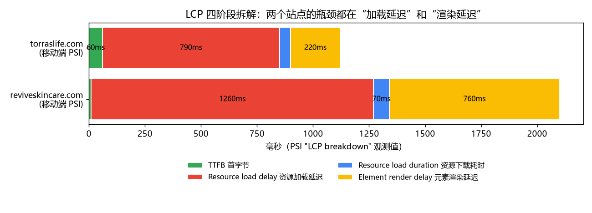

# 02. 诊断方法论：从指标到根因

> 上一章：[01. 读懂 PageSpeed Insights](01-pagespeed-basics.md) ｜ 下一章：[03. 案例一：torraslife.com](03-case-torraslife.md)

本章给出一套**固定顺序**的排查流程。按这个顺序走，可以避免“看到什么修什么”，把时间花在真正影响指标的地方。

## 2.1 五步排查法

```
第 1 步  看 Field：哪个 Core Web Vital 不达标？（没有 Field 就看 Origin）
   │
第 2 步  看 Lab 分数构成：哪个指标丢分最多？（+0 的那个）
   │
第 3 步  按指标筛选 Insights，只看和第 1、2 步相关的条目
   │
第 4 步  在明细表里找到“坐标”：URL / 选择器 / HTML 片段
   │      → 判断归属：主题代码？Section 设置？App？第三方脚本？内容（图片/视频）？
   │
第 5 步  修复 → 在相同条件下复测 3~5 次 → 上线后观察 Field 4 周
```

**归属判断**是 Shopify 优化特有的关键一步。同一个“JS 执行时间长”，可能是：

| 资源 URL 特征 | 归属 | 去哪里改 |
| --- | --- | --- |
| `/cdn/shop/t/<主题ID>/assets/...` | 主题文件 | 在线商店 → 主题 → 编辑代码（`assets/`、`sections/`、`snippets/`、`layout/theme.liquid`） |
| `/cdn/shop/files/...`、`/cdn/shop/products/...` | 商家上传的图片/文件 | 内容本身（重新导出），或主题里输出图片的 Liquid |
| `/cdn/shop/videos/...` | Shopify 托管视频 | Section 设置 + 输出 `<video>` 的 Liquid |
| `/cdn/shopifycloud/...`、`/checkouts/internal/...`、`/cdn/wpm/...` | Shopify 平台代码（加速结账、Web Pixels、统计等） | 多数不可控；部分可通过关闭功能/App 规避 |
| `/cdn/shop/t/<ID>/compiled_assets/...` | 主题 section 中 `` / `` 标签汇总的代码 | 对应 section 文件 |
| `/extensions/<uuid>/...` 或 `cdn.shopify.com/extensions/...` | **Theme App Extension（App embed / App block）** | 主题编辑器 → App embeds 开关 / 删除 App block |
| 其它域名（`*.klaviyo.com`、`*.attn.tv`、`browser.sentry-cdn.com`…） | 第三方 SaaS | App 设置、GTM、`theme.liquid` 里的手动代码、或 Customer events（Web Pixels） |

## 2.2 按指标的排查地图

### LCP 慢

先看 **LCP breakdown**，它把 LCP 拆成 4 段，**哪一段占比大就修哪一段**：



| 阶段 | 含义 | 偏大时的常见 Shopify 原因 | 修复方向 |
| --- | --- | --- | --- |
| **TTFB** | 请求到 HTML 第一个字节 | Liquid 渲染慢（嵌套循环遍历大集合、过多 `all_products`、复杂 section）、重定向链、地理跳转 App | 简化 Liquid；用 [Shopify Theme Inspector](https://github.com/Shopify/shopify-theme-inspector-for-chrome) 看 Liquid 火焰图；避免首屏重定向 |
| **Resource load delay** | HTML 开始到 LCP 资源**开始下载**的间隔 | LCP 图片被懒加载或由 JS 插入；被 CSS 背景图引用；前面的 HTML 太大导致图片标签到得晚；和大量高优先级请求抢带宽 | 让 LCP 图片在 HTML 前部以 `` 出现；`loading="eager"` + `fetchpriority="high"`；**只给 LCP 一个资源高优先级**；减小 HTML |
| **Resource load duration** | LCP 资源本身的下载时间 | 图片过大、未按设备尺寸给 `srcset`、PNG/GIF | `image_url` 指定 `width`、正确 `sizes`、Shopify CDN 自动 WebP/AVIF |
| **Element render delay** | 资源下载完到真正画出来 | 渲染阻塞 CSS/JS 未完成、轮播组件 JS 初始化后才显示首图、淡入动画、字体阻塞 | 减少渲染阻塞资源；首张幻灯片不依赖 JS 显示；去掉首屏入场动画 |

再看 **LCP request discovery**：三个勾（未懒加载、已加 fetchpriority=high、可在初始 HTML 中发现）都是绿色，说明“发现”这一层没问题，延迟来自别处（如带宽竞争或 HTML 太大）。

然后看 **Render-blocking requests**、**Network dependency tree**（关键请求链）、**Improve image delivery**、**Document request latency**。

### TBT 高 / INP 差

| 去看 | 你要找什么 |
| --- | --- |
| **Reduce JavaScript execution time**（bootup-time） | 按脚本/域名排序的 CPU 时间，找出最贵的 3–5 个 |
| **Minimize main-thread work** | 时间花在 Script Evaluation、Style & Layout、Rendering 还是 Parsing HTML |
| **3rd parties** | 每个第三方的传输体积和主线程时间 |
| **Avoid long main-thread tasks** | 具体的长任务及其来源 URL |
| **Reduce unused JavaScript** | 下载了但没执行的代码比例 |
| **Optimize DOM size** | 节点数、深度；DOM 越大，每次交互后的样式计算和布局越贵（直接影响 INP） |
| **Forced reflow** | JS 读布局属性（`offsetHeight` 等）导致的强制同步布局 |
| **Legacy JavaScript** / **Duplicated JavaScript** | 给现代浏览器发了 polyfill；同一个库被多个 App 重复打包 |

### CLS 高

看 **Layout shift culprits**：常见原因是图片/视频/iframe 没写 `width`/`height`（或 `aspect-ratio`）、App 动态插入的公告条/评价星级/弹窗、Web 字体切换导致的文字重排。

## 2.3 Insight → Shopify 修复速查表

| PSI 条目 | 在 Shopify 里通常意味着 | 首选修复（代码见 [第 5 章](05-shopify-fix-playbook.md)） |
| --- | --- | --- |
| LCP breakdown / LCP request discovery | 首屏 Banner、轮播首图、视频封面 | 首屏图用 `image_tag` 输出并设 `loading: 'eager', fetchpriority: 'high'`，其它图懒加载 |
| Render-blocking requests | `theme.liquid` 里的 `stylesheet_tag`、App 注入的 CSS、`compiled_assets/styles.css` | 关键 CSS 内联，非关键 CSS 异步加载；合并/裁剪 CSS |
| Network dependency tree | CSS 里 `@import`、CSS 引字体、JS 再加载 JS 的链式请求 | 打平依赖链；`preload` 关键字体；减少 `preconnect` 到最多 4 个真正需要的域 |
| Improve image delivery | 原图上传过大、`width=` 参数过大、GIF 动图、第三方弹窗大图 | `image_url: width:`+`srcset`+`sizes`；GIF 改 MP4/WebP；要求 App 供应商压缩素材 |
| Use efficient cache lifetimes | 多数是第三方资源的短缓存 | Shopify CDN 资源通常已长缓存；第三方只能换供应商或延迟加载 |
| 3rd parties / JS execution time | App embed、GTM 里堆积的标签、聊天/评价/弹窗/风控/监控 | 删除不用的 App；**按页面条件加载**；**交互或空闲后再加载** |
| Reduce unused JavaScript | 全站加载但只在某个模板用到的脚本 | 用 `template.name` 条件输出；按需动态 `import()` |
| Optimize DOM size | 超大菜单、购物车抽屉、首页 section 过多、内联 SVG | 菜单/抽屉按需渲染（Section Rendering API）、SVG 用 sprite、精简 section |
| Font display | `@font-face` 未设 `font-display` | Shopify `font_face` 过滤器加 `font_display: 'swap'` |
| Page prevented back/forward cache restoration | `unload` 监听、`Cache-Control: no-store` 等 | 移除 `unload` 监听（常来自旧版第三方脚本） |
| Document request latency | HTML 未压缩、有重定向、服务器慢 | Shopify 已负责压缩；排查重定向和 Liquid 渲染耗时 |

## 2.4 必备工具

| 工具 | 用途 |
| --- | --- |
| [PageSpeed Insights](https://pagespeed.web.dev/) | Field + Lab 一站式 |
| Chrome DevTools → **Lighthouse** 面板 | 本地复现；可测试未发布主题的预览链接 |
| Chrome DevTools → **Performance** 面板 | 录制加载过程和**交互过程**（诊断 INP 必用）；看 LCP 元素、长任务、布局偏移 |
| Chrome DevTools → **Network** 面板 | 按 Priority 列查看请求优先级；Block request URL 可模拟“去掉某个 App 后的效果” |
| Chrome DevTools → **Coverage** 面板 | 查看 CSS/JS 未使用比例 |
| [Shopify Theme Inspector](https://github.com/Shopify/shopify-theme-inspector-for-chrome) | Liquid 渲染火焰图，定位 TTFB 慢的 section |
| [web-vitals](https://github.com/GoogleChrome/web-vitals) JS 库 | 采集真实用户数据，含 INP 归因（attribution build） |
| [CrUX Vis](https://cruxvis.withgoogle.com/) / CrUX API | 查看真实用户数据的历史趋势 |
| 本仓库 [scripts/](../scripts) | 从 Lighthouse JSON 提取诊断；统计 Shopify HTML 体积构成 |

> **一个高效技巧：用“请求屏蔽”量化 App 的影响。** 在 DevTools Network 面板右键某个第三方请求 → *Block request domain*，然后在 Lighthouse 面板重新测试。这样可以在不动线上代码的情况下，估算“如果去掉/延迟这个 App，指标会改善多少”，作为和运营/市场沟通的依据。

接下来两章用真实案例完整演示这套流程。
