# 03. 案例一：torraslife.com（Woodstock 主题，深度定制）

> 上一章：[02. 诊断方法论](02-diagnosis-workflow.md) ｜ 下一章：[04. 案例二：reviveskincare.com](04-case-reviveskincare.md)
>
> 测试时间：2026-11-09 11:53 UTC ｜ [原始 PSI 报告](https://pagespeed.web.dev/analysis/https-torraslife-com/8vnxxui4n0?form_factor=mobile) ｜ 主题：`Woodstock 1.3.0`（主题名“正式上线版”，大量 `yg_*` 自定义 section）
>
> 说明：本章所有“修复建议”都是基于公开页面的外部分析，未接触店铺后台。标注 **【推断】** 的结论需要在后台/主题代码里验证。

## 3.1 第 1 步：Field —— 谁不达标？

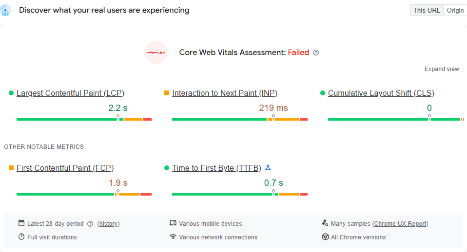

| 指标（p75，近 28 天） | 移动端 | 桌面端 |
| --- | --- | --- |
| LCP | 2.2 s ✅ | 2.1 s ✅ |
| **INP** | **219 ms ⚠️** | 111 ms ✅ |
| CLS | 0 ✅ | 0.02 ✅ |
| FCP | 1.9 s ⚠️ | 1.7 s ✅ |
| TTFB | 0.7 s ✅ | 0.6 s ✅ |
| 结论 | **Failed（因 INP）** | Passed |

**结论 1：真实用户层面，TORRAS 唯一不达标的是移动端 INP。** 这决定了我们的第一优先级不是“提分”，而是“让手机上的点击更快有反应”。LCP 2.2 s 已经接近 2.5 s 阈值，是第二优先级。

## 3.2 第 2 步：Lab —— 分数丢在哪？

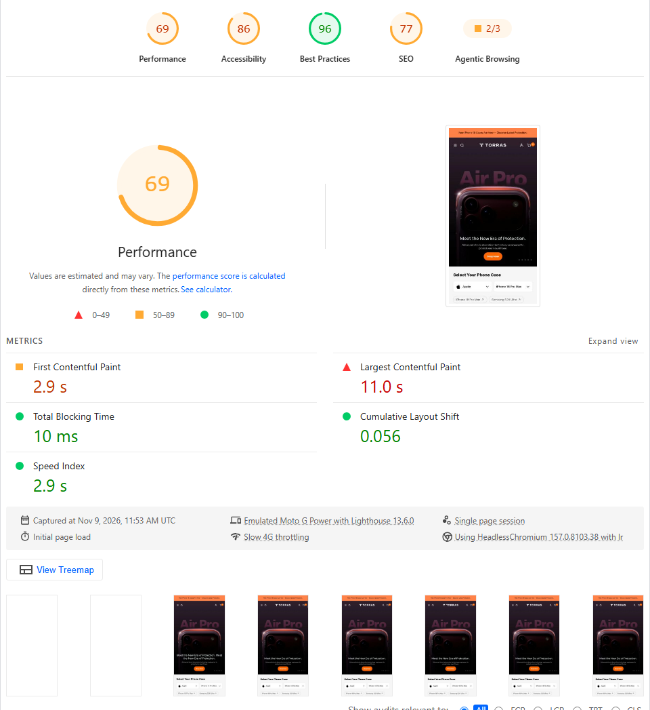

| 指标 | 移动端 | 得分贡献 | 桌面端 |
| --- | --- | --- | --- |
| 性能分 | **69** | | 93 |
| FCP | 2.9 s | +5 / 10 | 0.6 s |
| **LCP** | **11.0 s** | **+0 / 25** | 1.7 s |
| TBT | 10 ms | +30 / 30 | 60 ms |
| CLS | 0.056 | +25 / 25 | 0.013 |
| SI | 2.9 s | +10 / 10 | 1.1 s |

**结论 2：Lab 分数几乎全部输在 LCP。** 而 Lab 里 TBT 只有 10 ms，说明“加载阶段的 JS”在 PSI 环境下并不重——这与 Field 的 INP 不达标并不矛盾（见 [1.2](01-pagespeed-basics.md#12-core-web-vitals-与其它指标)），它提示 INP 问题出在**交互时**。

## 3.3 第 3 步：LCP 诊断

### LCP 元素是谁

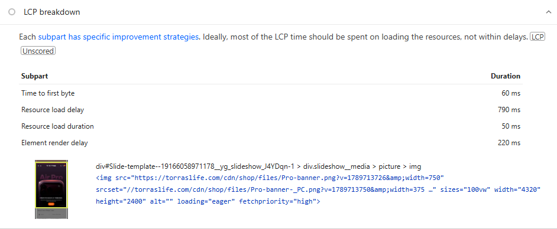

LCP 元素是首页轮播（`yg_slideshow` section）第一张幻灯片的图片：

```html

```

LCP breakdown（观测值）：

| 阶段 | 耗时 | 占比 |
| --- | --- | --- |
| TTFB | 60 ms | 5% |
| **Resource load delay** | **790 ms** | **70%** |
| Resource load duration | 50 ms | 4% |
| Element render delay | 220 ms | 20% |

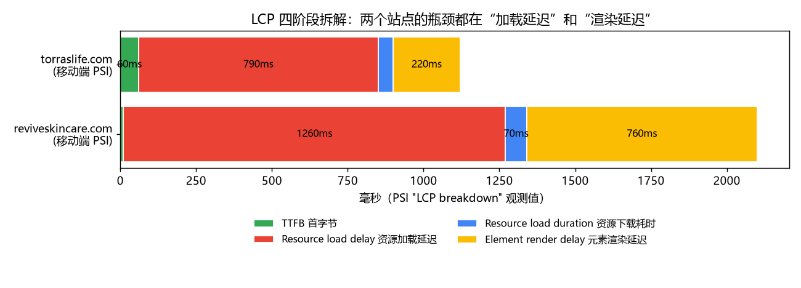

**解读：** 图片本身下载只用了 50 ms（说明图片体积不是问题），70% 的时间花在“HTML 开始加载 → 浏览器开始请求这张图”之间。

### “发现”环节没问题

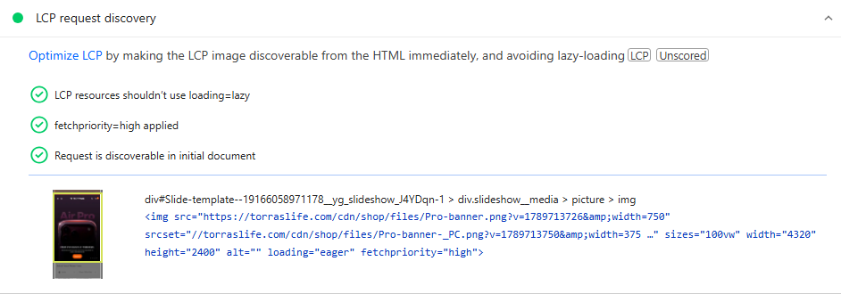

三项全部通过：没有懒加载、有 `fetchpriority=high`、在初始 HTML 中可被发现。**那 790 ms 的延迟从哪来？** 按 [2.2](02-diagnosis-workflow.md#lcp-慢) 的表格继续排查剩下两个原因：“HTML 太大，图片标签到得晚”和“和其它高优先级请求抢带宽”。

### 根因 A：HTML 文档本身过大

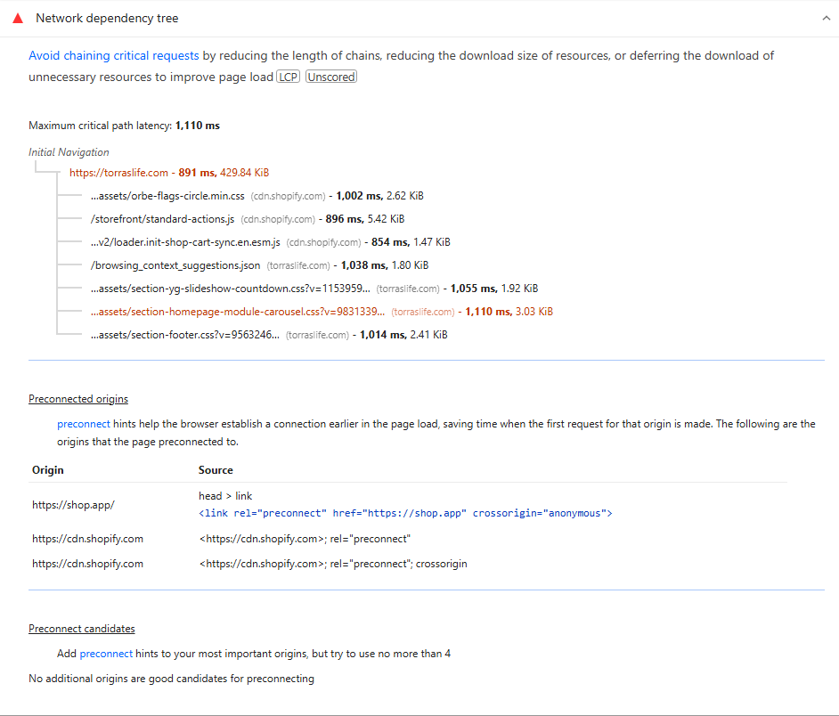

*Network dependency tree 的第一行：HTML 文档 `https://torraslife.com` 传输 **429.84 KiB**、耗时 891 ms。一般 Shopify 首页 HTML 压缩后在 50–150 KiB。*

我们下载首页 HTML，用 [scripts/analyze-shopify-html.py](../scripts/analyze-shopify-html.py) 统计（未压缩体积）：

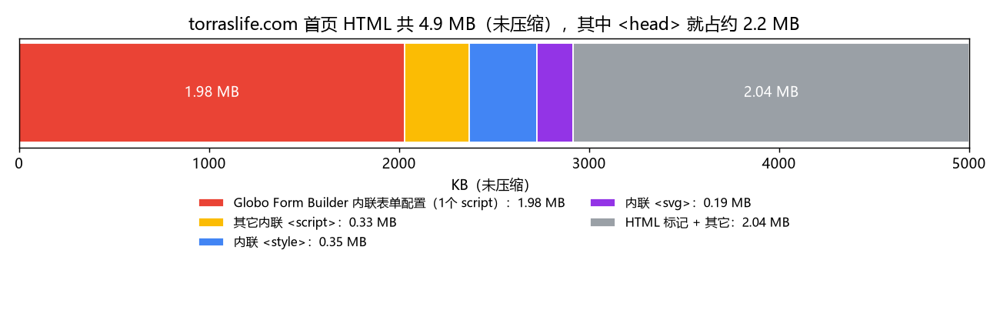

| 发现 | 数据 |
| --- | --- |
| HTML 总体积（未压缩） | **约 4.9 MB** |
| `<head>` 部分 | **约 2.2 MB**（LCP 图片在 `<body>` 里，浏览器必须先下载并解析完这些字节才能“看到”它） |
| 最大的单个 `<script>` | **约 1.98 MB**：`var Globo = Globo || {}; var globoFormbuilderRecaptchaInit…`，即 **Globo Form Builder（Powerful Form Builder）** App 内联的表单配置 |
| 内联 `<script>` 合计 | 约 2.3 MB |
| 内联 `<style>` 合计 | 约 0.35 MB（大量 section 级 `<style>`） |
| 内联 `<svg>` | 216 个，约 0.19 MB |
| base64 内嵌图片（`data:image/…;base64`） | 约 90 处 |
| 最大的 section 输出 | `cart-drawer` **约 1.0 MB**、`yg_product_category` 约 0.6 MB、`header` 约 0.6 MB |
| `fetchpriority` 属性 | **102 处**，其中 `high` **8 处** |

**为什么 HTML 大会拖慢 LCP：** 浏览器的预加载扫描器是边下载边扫描 HTML 的。LCP 图片标签前面有 2 MB 以上的内联脚本和样式，在 Slow 4G 下，这些字节要先传完，图片请求才能发出——这正是 “Resource load delay” 的含义。同时，HTML 解析、内联脚本的编译也占用主线程。

### 根因 B：高优先级被“稀释”

`fetchpriority="high"` 的意义在于**只告诉浏览器“这一个最重要”**。TORRAS 首页 HTML 中有 102 处 `fetchpriority` 属性，其中 **8 个元素是 `high`**——除了 LCP 图片，还有视频封面等资源也在要求最高优先级，与真正的 LCP 图片争抢早期带宽。

*Improve image delivery* 里排第一的就是一个例子：

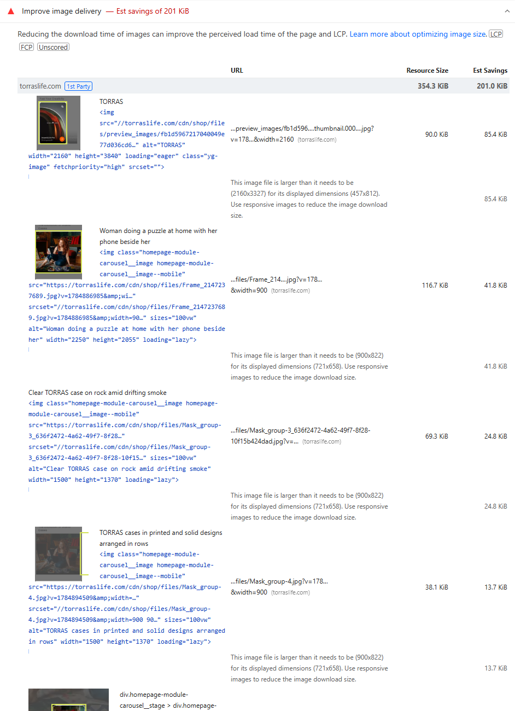

```html
<!-- 视频封面：请求了 2160 宽的图，实际显示 457×812；并且带了 eager + high -->

```

这个封面图存在三个问题：`srcset=""` 是空的（浏览器无法按屏幕选尺寸）；请求 2160 px 宽而显示只有 457 px（多下载 85 KiB）；带着 `fetchpriority="high"` 和 `loading="eager"`，如果它不在首屏，就是在和 LCP 抢带宽。**【推断】** 这是 `yg_videos` 等自定义 section 统一给图片加了 high 优先级。

### 根因 C：渲染阻塞 CSS（Element render delay 的主要来源）

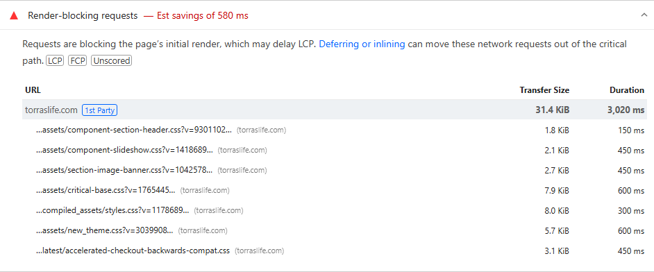

7 个 CSS 合计只有 31.4 KiB，但因为是串行阻塞首帧，PSI 估算可节省 580 ms：

| 文件 | 来源 | 建议 |
| --- | --- | --- |
| `component-section-header.css`、`component-slideshow.css`、`section-image-banner.css` | 主题，首屏 section | 首屏必需，适合**内联为关键 CSS** |
| `critical-base.css`、`new_theme.css` | 主题 | 合并为一个文件；非首屏规则拆出去异步加载 |
| `compiled_assets/styles.css` | 各 section 的 `` 标签汇总 | 把非首屏 section 的样式移到 section 内按需加载 |
| `accelerated-checkout-backwards-compat.css` | Shopify 平台（加速结账按钮） | 平台控制，一般无需处理 |

主题已经对 `base.css`、`torras.css`、`swiper-bundle.min.css` 使用了 `rel="preload" onload="this.rel='stylesheet'"` 的异步写法，方向是对的，只需把同样的策略应用到剩余的非关键 CSS 上。

### LCP 的修复清单（按收益排序）

1. **把 Globo Form Builder 的 2 MB 配置移出 HTML**：首页没有表单时不输出；或改为只在包含表单的页面输出；或联系 App 方改为按需请求 JSON。这一项预计可让 HTML 体积减少约 40%。
2. **精简 `cart-drawer`**：购物车抽屉 1 MB 标记，**【推断】** 很可能把推荐商品/赠品/多语言内容全量渲染进了每个页面。改为打开抽屉时通过 [Section Rendering API](https://shopify.dev/docs/api/section-rendering) 拉取（代码见 [5.6](05-shopify-fix-playbook.md#56-用-section-rendering-api-按需渲染购物车抽屉菜单)）。
3. **只给 LCP 图片 `fetchpriority="high"`**：在主题里搜索 `fetchpriority`，8 个 `high` 中除首屏第一张幻灯片外全部移除。
4. **视频封面使用正确的 `srcset` 和 `sizes`**，非首屏封面改为 `loading="lazy"`。
5. **内联首屏关键 CSS**，其余 CSS 异步加载。
6. **检查 LCP 图片的 `src` 与 `srcset` 指向不同文件**（`Pro-banner.png` 与 `Pro-banner-_PC.png`）：当 `srcset` 使用 `w` 描述符时，浏览器只会从 `srcset` 里选择。如果移动端要显示单独的竖版图，应该用 `<picture><source media="(max-width: 749px)" srcset="…">` 做艺术指导，而不是靠 `src`。另外 PNG 原图宽 4320 px，建议上传时就导出合适尺寸的 JPG/WebP，减少 CDN 转码负担。

## 3.4 第 4 步：INP 诊断（Field 不达标的根因）

Lab 无法直接测 INP，我们用**间接证据**定位：

### 证据 1：DOM 规模

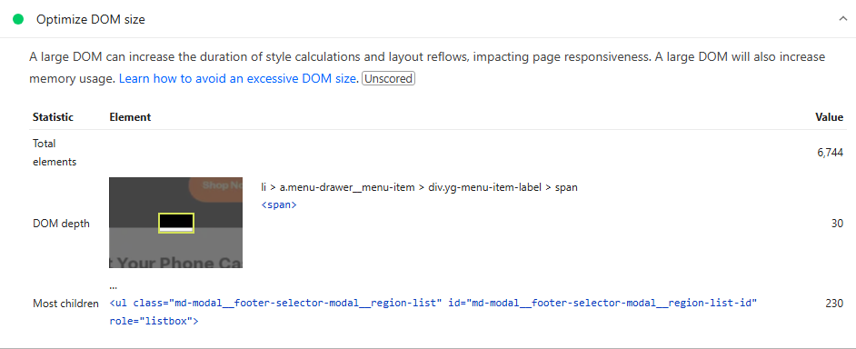

| 统计 | 值 |
| --- | --- |
| 总元素数 | **6,744**（旧版 Lighthouse 在超过 1,400 个元素时直接判定为“差”） |
| 最大深度 | 30（`li > a.menu-drawer__menu-item > div.yg-menu-item-label > span`，手机菜单） |
| 子元素最多 | 230（页脚国家/地区选择器的 `<ul … region-list>`） |

**为什么 DOM 大会导致 INP 差：** 每次交互（打开菜单、点击“加入购物车”、切换轮播）如果修改了样式或类名，浏览器需要重新计算受影响元素的样式并布局。节点越多，这一步越慢，下一帧就越晚画出来。TORRAS 的 header 中有 mega menu 的 hover 脚本（`// Header mega-menu hover effect - add header-active class to header`），给 `<header>` 加类名可能触发整个头部大量节点的样式重算。

### 证据 2：强制同步布局

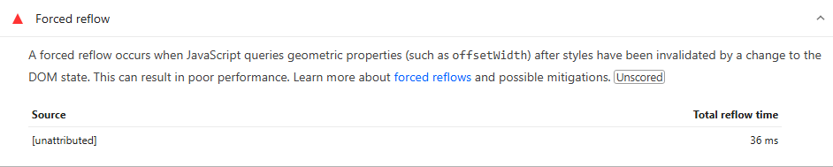

Forced reflow 列出了“先改 DOM、再读布局属性”导致浏览器被迫立刻布局的 JS 位置。这类代码如果出现在点击处理函数里，会直接加长 INP 的 *processing duration*。

### 证据 3：第三方脚本

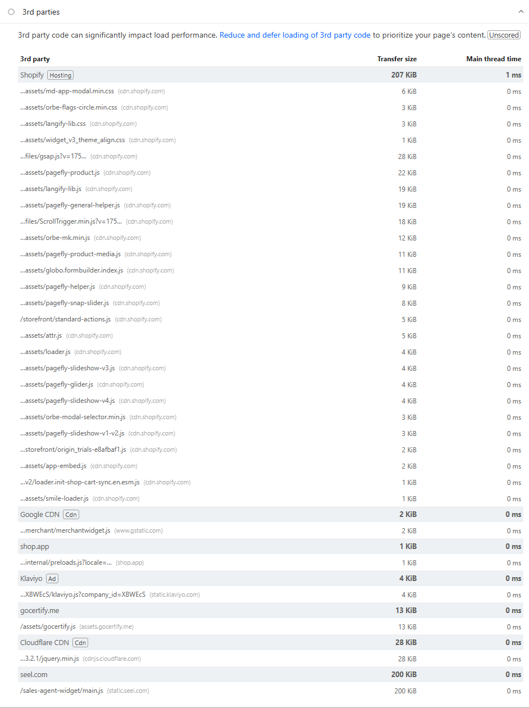

在 PSI 这次测试中，大部分第三方几乎没有主线程时间（很多 App 延迟到用户交互或空闲后才加载）。但在本地 Lighthouse（更慢的 CPU）中，第三方的成本就暴露出来了：

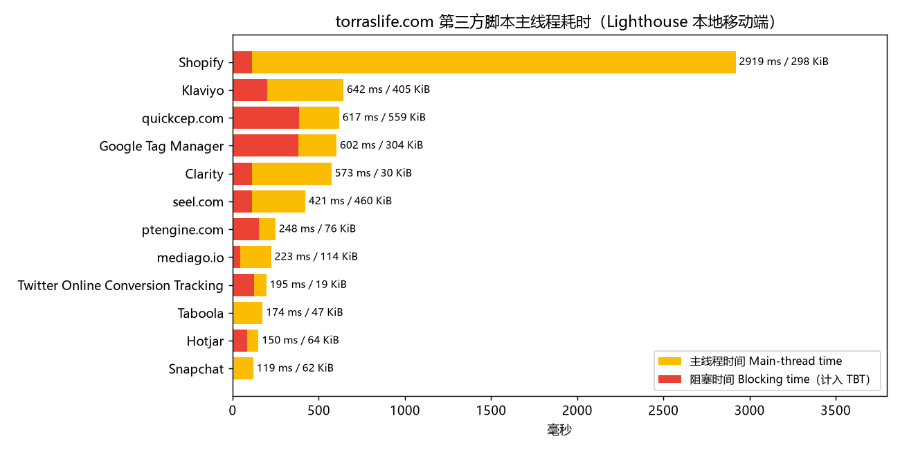

页面上能看到的第三方/App 包括：Klaviyo、QuickCEP（客服）、Google Tag Manager、Microsoft Clarity、Seel（退货险）、Ptengine、MediaGo、Twitter/Snapchat 像素、Taboola、Hotjar，以及 Shopify CDN 上的 PageFly、Langify、Orbe 地理定位、Judge.me、Globo Form Builder、Attribuly、GSAP/ScrollTrigger 等。

**关键认识：** “延迟到首次交互再加载”的 App 会让 Lab 好看，但**用户第一次点击时，这些脚本一起下载、解析、执行，恰好压在这次交互上**，反而让 INP 变差。这是 **【推断】** TORRAS 移动端 INP 偏高的重要原因之一，需要用下面的方法确认。

### 如何确认 INP 根因（实操）

1. 手机或 DevTools 中开启 *CPU 4x slowdown*，打开 Performance 面板，勾选 *Web Vitals*，开始录制。
2. 依次执行真实用户最常见的操作：点开汉堡菜单、点击轮播箭头、进入商品页点击“Add to cart”、打开购物车抽屉。
3. 停止录制，在 *Interactions* 轨道找到最长的交互，看它的三段：*Input delay*（主线程被别的任务占着）、*Processing duration*（事件处理函数本身）、*Presentation delay*（样式/布局/绘制）。
4. 对应修复：Input delay 大 → 减少/拆分同时运行的脚本（尤其是“交互时才加载”的 App）；Processing 大 → 优化事件处理函数，把非必要工作 `await` 到下一帧之后；Presentation 大 → 减小 DOM、避免大范围类名切换。
5. 上线 [web-vitals attribution](05-shopify-fix-playbook.md#512-用-web-vitals-采集真实用户-inp-归因) 收集真实用户中最慢交互的元素和脚本。

### INP 的修复清单

1. **缩小 DOM**：手机菜单、mega menu、国家选择器（230 个选项）、购物车抽屉改为按需渲染；216 个内联 SVG 改为 `<use href="#icon">` sprite。
2. **mega menu 悬停/点击效果尽量用 CSS 实现**（`:hover`、`:focus-within`、`details[open]`），避免 JS 给 `<header>` 切换类名。
3. **错开第三方加载**：不要把所有 App 都绑定在“第一次交互”上；用 `requestIdleCallback` 分批加载，并删除重复/不再使用的追踪像素（Hotjar、Clarity、Ptengine 三个都是热图/录屏工具，通常保留一个即可）。
4. **事件处理函数让出主线程**（`scheduler.yield()` 或 `setTimeout` 拆分），代码见 [5.9](05-shopify-fix-playbook.md#59-inp让交互先画出来)。

## 3.5 其它次要项

| 条目 | 截图 | 说明 |
| --- | --- | --- |
| Use efficient cache lifetimes | [查看](../images/torras/torras-mobile-a-cache-insight.png) | 主要是第三方资源的短缓存，主题资源在 Shopify CDN 上已长缓存，优先级低 |
| Legacy JavaScript | [查看](../images/torras/torras-mobile-a-legacy-javascript-insight.png) | 某些脚本为旧浏览器打包了 polyfill；主题自研 JS 可用现代语法构建 |
| Reduce unused JavaScript | [查看](../images/torras/torras-mobile-a-unused-javascript.png) | 全站加载的 PageFly、GSAP/ScrollTrigger 等，只在用到的模板加载 |
| Long main-thread tasks | [查看](../images/torras/torras-mobile-a-long-tasks.png) | 与 INP 排查结合看 |
| Document request latency | [查看](../images/torras/torras-mobile-a-document-latency-insight.png) | HTML 已压缩，无重定向；体积是主要问题 |
| Layout shift culprits | [查看](../images/torras/torras-mobile-a-cls-culprits-insight.png) | CLS 0.056，Field 为 0，无需优先处理 |

## 3.6 TORRAS 的优化路线图

| 优先级 | 动作 | 影响指标 | 难度 | 验证方式 |
| --- | --- | --- | --- | --- |
| P0 | 移除/按需输出 Globo Form Builder 内联配置 | LCP、FCP、INP | 低（App 设置或 1 处 Liquid 条件） | HTML 体积、Network 树第一行 |
| P0 | 只保留 LCP 图片的 `fetchpriority="high"` | LCP | 低 | DevTools Network 的 Priority 列 |
| P1 | 购物车抽屉、菜单、国家选择器按需渲染 | INP、LCP | 中 | DOM 元素数、Performance 交互录制 |
| P1 | 审计 App/像素，删除重复的热图/录屏和不再投放的广告像素，错峰加载其余脚本 | INP | 中（需与运营沟通） | 本地 Lighthouse TBT、RUM INP |
| P2 | 关键 CSS 内联、其余异步 | LCP、FCP | 中 | Render-blocking 条目消失 |
| P2 | 视频封面 `srcset`/懒加载、SVG sprite、约 90 处 base64 图片外链 | LCP、HTML 体积 | 低 | Image delivery 节省量 |

**预期：** 完成 P0 后重点看 LCP breakdown 中 Resource load delay 是否明显下降；完成 P1 后观察 4 周内 CrUX 移动端 INP 是否回到 200 ms 以下。

## 附录：更多截图

| 截图 | 说明 |
| --- | --- |
| [移动端 JS 执行时间](../images/torras/torras-mobile-a-bootup-time.png) | Reduce JavaScript execution time |
| [移动端主线程工作分解](../images/torras/torras-mobile-a-mainthread-work-breakdown.png) | Minimize main-thread work |
| [移动端网络负载](../images/torras/torras-mobile-a-total-byte-weight.png) | Avoid enormous network payloads |
| [桌面端 Field](../images/torras/torras-desktop-01-field.png) | 桌面端 CWV Passed（LCP 2.1 s / INP 111 ms / CLS 0.02） |
| [桌面端 Lab](../images/torras/torras-desktop-02-lab.png) | 桌面端性能分 93 |
| [桌面端 Insights](../images/torras/torras-desktop-03-insights.png) | 桌面端 Insights 列表 |
| [桌面端 LCP breakdown](../images/torras/torras-desktop-a-lcp-breakdown-insight.png) | 桌面端 LCP 阶段 |
| [桌面端 DOM size](../images/torras/torras-desktop-a-dom-size-insight.png) | 桌面端 DOM 统计 |
| [桌面端 3rd parties](../images/torras/torras-desktop-a-third-parties-insight.png) | 桌面端第三方 |
