# 04. 案例二：reviveskincare.com（Impulse 主题）

> 上一章：[03. 案例一：torraslife.com](03-case-torraslife.md) ｜ 下一章：[05. Shopify 修复手册](05-shopify-fix-playbook.md)
>
> 测试时间：2026-11-09 12:01 UTC ｜ [原始 PSI 报告](https://pagespeed.web.dev/analysis/https-reviveskincare-com/tk5735ers9?form_factor=mobile) ｜ 主题：`Impulse 7.6.0`（主题名 `ReVive-Skincare/main`，**【推断】** 通过 GitHub 集成管理）
>
> 标注 **【推断】** 的结论需要在后台/主题代码里验证。

## 4.1 第 1 步：Field —— 真实用户其实不错

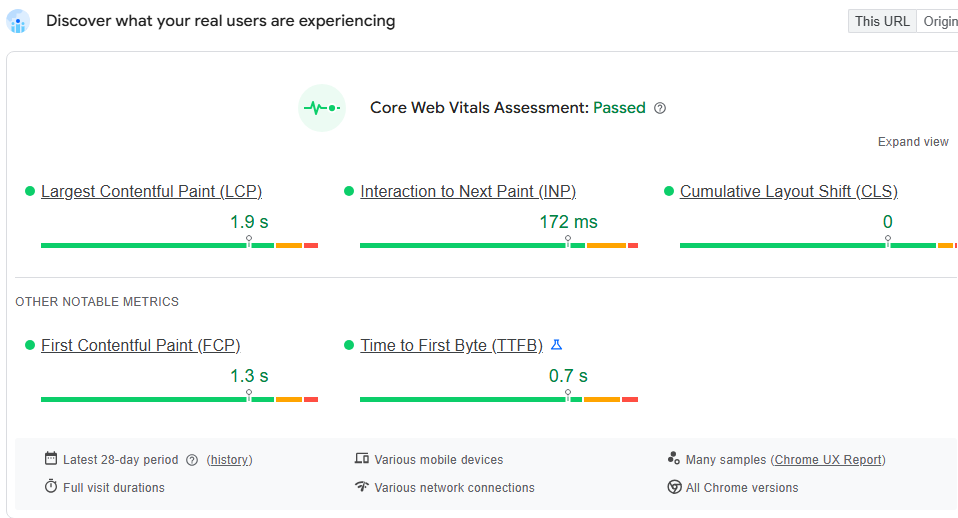

| 指标（p75） | 移动端 | 桌面端 |
| --- | --- | --- |
| LCP | 1.9 s ✅ | 1.9 s ✅ |
| INP | 172 ms ✅ | 129 ms ✅ |
| CLS | 0 ✅ | 0.03 ✅ |
| FCP | 1.3 s ✅ | 1.3 s ✅ |
| TTFB | 0.7 s ✅ | 0.7 s ✅ |
| 结论 | **Passed** | **Passed** |

**结论 1：** ReVive 的真实用户（以回访、快网络为主）体验达标。但移动端 INP 172 ms 离 200 ms 阈值只有 28 ms，再加一个重型脚本就可能失败。

## 4.2 第 2 步：Lab —— 移动端和桌面端都只有 44–45 分

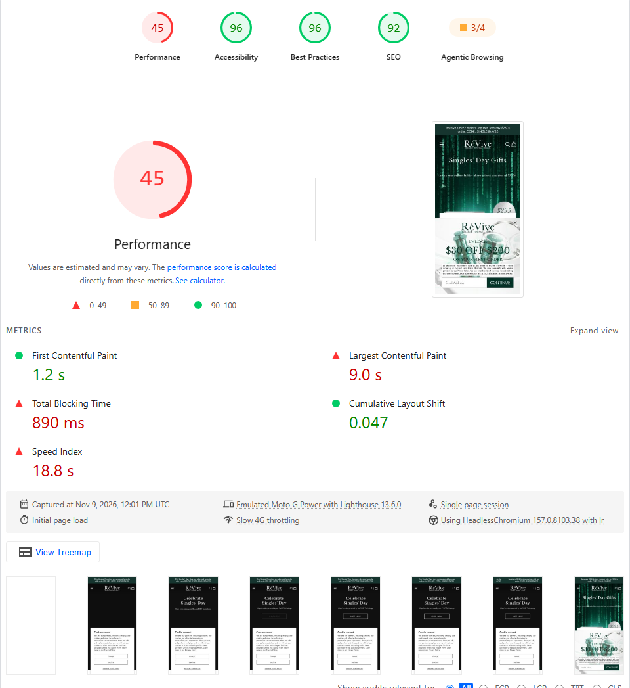

| 指标 | 移动端 | 得分贡献 | 桌面端 |
| --- | --- | --- | --- |
| 性能分 | **45** | | **44** |
| FCP | 1.2 s | +10 / 10 | 0.3 s |
| **LCP** | **9.0 s** | **+0 / 25** | **8.6 s** |
| **TBT** | **890 ms** | **+10 / 30** | 510 ms |
| CLS | 0.047 | +25 / 25 | 0.012 |
| **Speed Index** | **18.8 s** | **+0 / 10** | 4.8 s |

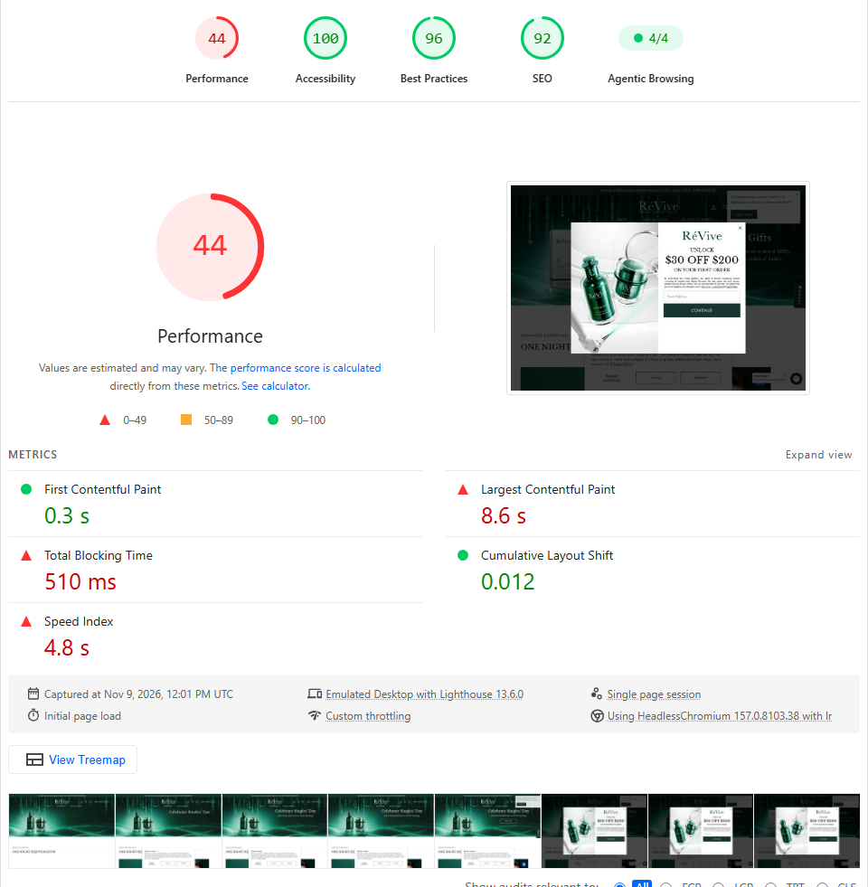

**结论 2：** 和 TORRAS 不同，ReVive 的 FCP 很快（1.2 s，说明 HTML 和首屏 CSS 基本健康），但 LCP、TBT、SI 都很差，**而且桌面端也一样差**。桌面端网络和 CPU 都更好却仍然是 8.6 s 的 LCP，说明问题不是“手机太慢”，而是**页面加载的东西太多**。

## 4.3 先看“体积账单”

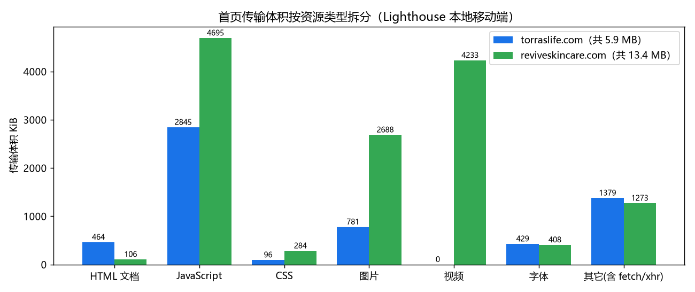

*本地 Lighthouse 移动端的传输体积统计（单次测试，第三方内容每次可能不同）：ReVive 首页总传输约 13.4 MB，其中视频约 4.2 MB、JS 约 4.7 MB、图片约 2.7 MB；HTML 仅 106 KiB。TORRAS 正好相反：HTML 464 KiB 是 ReVive 的 4 倍多，但总量只有 5.9 MB。*

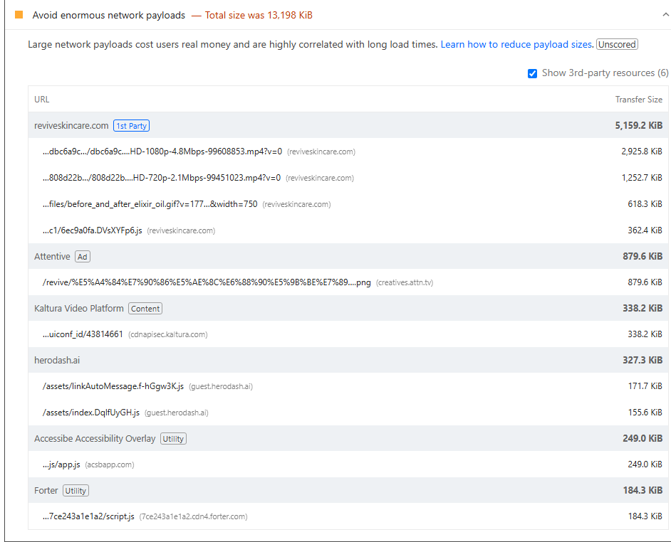

*Avoid enormous network payloads 中排在前面的是首屏 Hero 视频：*

| 资源 | 体积 | 说明 |
| --- | --- | --- |
| `…/cdn/shop/videos/…/dbc6a9c7….HD-1080p-4.8Mbps-….mp4` | **约 2,926 KiB** | 移动端首屏 Hero 视频，1080p、4.8 Mbps 码率 |
| `…/cdn/shop/videos/…/808d22b4….HD-720p-2.1Mbps-….mp4` | 约 1,252 KiB | 另一个 Hero 视频（**【推断】** 桌面端版本，被隐藏但仍然下载） |
| Attentive 弹窗图片 `creatives.attn.tv/revive/…png` | 约 879 KiB | 第三方邮件订阅弹窗素材 |
| `before_and_after_elixir_oil.gif` | 约 617 KiB | GIF 动图 |

## 4.4 第 3 步：LCP 诊断

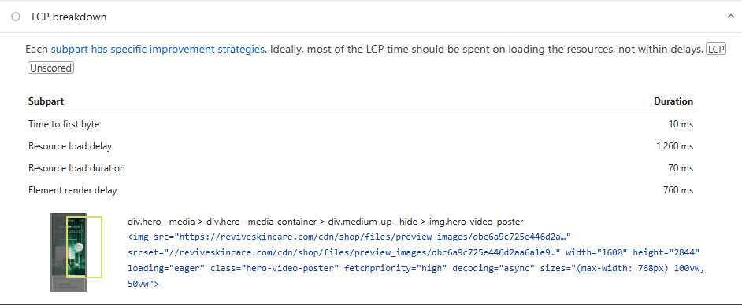

LCP 元素是 **Hero 视频的封面图**：

```html
<div class="hero__media"><div class="hero__media-container"><div class="medium-up--hide">
  
```

| 阶段 | 耗时 | 占比 |
| --- | --- | --- |
| TTFB | 10 ms | 0.5% |
| **Resource load delay** | **1,260 ms** | **60%** |
| Resource load duration | 70 ms | 3% |
| **Element render delay** | **760 ms** | **36%** |

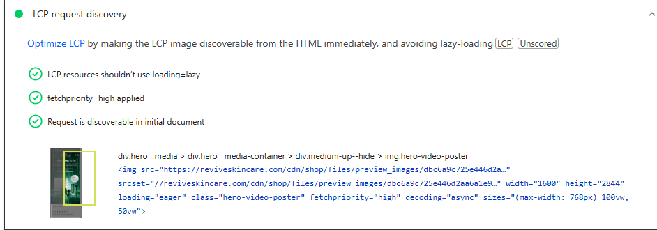

**主题的“写法”是对的**：LCP request discovery 三项全部通过（eager、fetchpriority=high、HTML 可发现），封面图也有 `srcset` 和 `sizes`。所以要找的是“**写法正确，但还是慢**”的原因：

### 根因 A：首屏视频与 LCP 图片抢带宽

封面图和 2.9 MB 的视频几乎同时开始下载。Slow 4G 约 1.6 Mbps 的带宽下，视频会占据绝大部分带宽，封面图的“load delay”被拉长；Lantern 模拟时，视频、JS、图片都排进同一个带宽模型，最终把 LCP 推到 9 s。**【推断】** Speed Index 18.8 s 也与视频有关：自动播放的视频持续改变首屏画面，Speed Index 会认为“视觉上一直没完成”。

修复：

1. **移动端 Hero 不要用 1080p / 4.8 Mbps 视频。** 9:16 竖屏在手机上 720p、1–1.5 Mbps 足够，或者控制在 1 MB 以内。Shopify 视频会生成多种清晰度，可以在 Liquid 里选择更低码率的 `source`（见 [5.4](05-shopify-fix-playbook.md#54-首屏视频先画封面再加载视频)）。
2. **视频设为 `preload="none"`，在 LCP（封面图）完成、页面 `load` 之后再挂载 `<source>` 并播放。** 封面图就是 LCP，视频晚 1–2 秒开始播放用户几乎无感。
3. **只下载当前断点需要的视频**：`medium-up--hide` / `small--hide` 只是用 CSS 隐藏，`<video>` 依然可能下载。用 JS 根据 `matchMedia` 只给可见的那个 `<video>` 设置 `src`。
4. 封面图 1600×2844 偏大，`sizes` 为 `100vw` 的手机屏幕，用 `width` 上限 1080 已足够清晰。

### 根因 B：渲染阻塞 CSS 与关键请求链（Element render delay 760 ms）

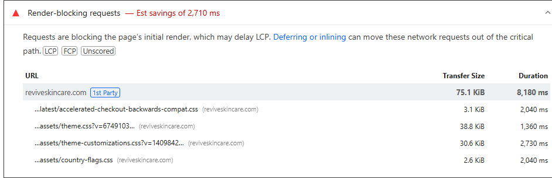

| 文件 | 体积 | 耗时 | 建议 |
| --- | --- | --- | --- |
| `theme.css` | 38.8 KiB | 1,360 ms | Impulse 主题主样式，抽取首屏关键 CSS 内联 |
| `theme-customizations.css` | 30.6 KiB | 2,730 ms | **定制样式几乎和主题主样式一样大**，应合并进 `theme.css` 或拆为按 section 加载 |
| `country-flags.css` | 2.6 KiB | 2,040 ms | 只在打开国家/币种选择器时需要，改为异步 |
| `accelerated-checkout-backwards-compat.css` | 3.1 KiB | 2,040 ms | Shopify 平台 |

PSI 估算可节省 **2,710 ms**，是 ReVive 单项估算最大的 Insight。

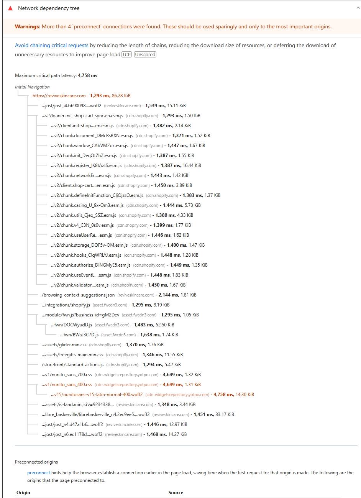

Network dependency tree 的发现：

- **最长关键链 4,758 ms**：`cdn-widgetsrepository.yotpo.com/v1/nunito_sans_400.css` → `nunitosans-v15-latin-normal-400.woff2`。这是 **Yotpo 评价组件**引入的字体 CSS，再由 CSS 引入字体文件，形成“HTML → CSS → 字体”的三级链，而且是第三方域名。评价组件通常在首屏之下，**这个字体链不该在关键路径上**。
- PSI 警告 *More than 4 preconnect connections were found*：预连接太多反而会和关键请求抢连接资源。只保留 1–2 个首屏确实需要的域名。
- 首屏同时加载了 Jost（3 个字重）和 Libre Baskerville 共 4 个字体文件；确认每个字重都被首屏使用，否则减少字重或只 `preload` 一个。

## 4.5 第 4 步：TBT 诊断（890 ms）

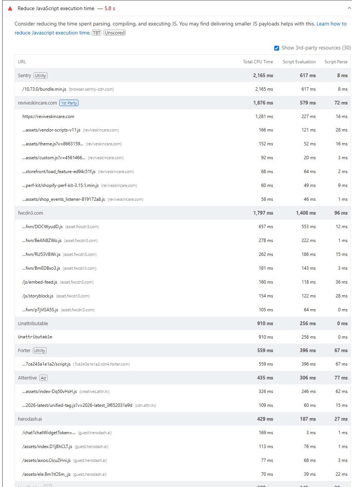

*Reduce JavaScript execution time — 5.8 s。按 CPU 时间排序的前几名：*

| 来源 | 总 CPU 时间 | 类型 | 说明 |
| --- | --- | --- | --- |
| **Sentry**（`browser.sentry-cdn.com/10.73.0/bundle.min.js`） | **2,165 ms** | 错误监控 | 只有 30 KiB，却是 CPU 最贵的脚本 |
| reviveskincare.com（第一方） | 1,876 ms | 主题 + Shopify | 其中 HTML 本身解析 1,281 ms，`vendor-scripts-v11.js` 166 ms，`theme.js` 152 ms |
| **Firework**（`fwcdn3.com`） | 1,797 ms | 视频购物组件 | 735 KiB，几十个分块 |
| Unattributable | 910 ms | — | 无法归属的浏览器工作（多为样式/布局/GC） |
| Forter | 559 ms | 风控 | |
| Attentive | 435 ms | 短信/邮件弹窗 | |
| herodash.ai | 429 ms | AI 聊天组件 | |

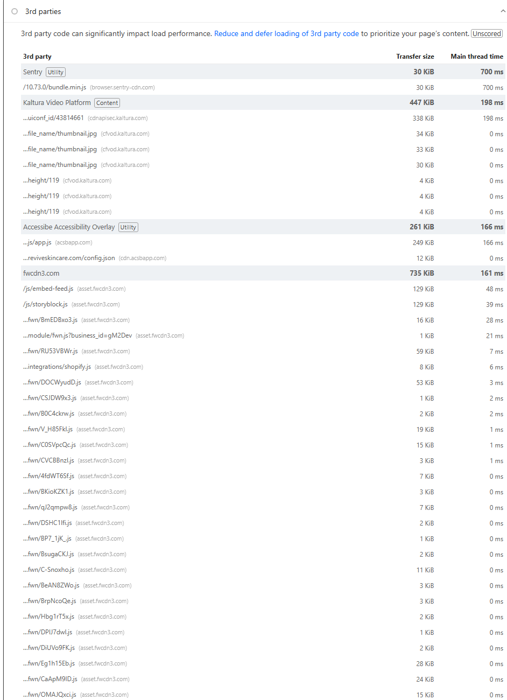

*3rd parties：Sentry 700 ms 主线程时间；Kaltura Video Platform 447 KiB / 198 ms；accessiBe 无障碍浮层 261 KiB / 166 ms；fwcdn3.com（Firework）735 KiB / 161 ms。*

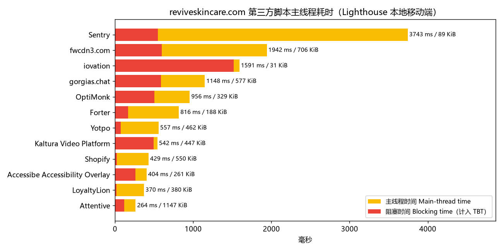

逐个分析：

1. **Sentry（2.2 s CPU）**：`bundle.min.js` 是包含全部功能的完整包。**【推断】** 很可能开启了 Session Replay 或 Performance Tracing（这两项会在主线程做大量工作）。修复：改用只含错误捕获的精简包、关闭或大幅降低 `replaysSessionSampleRate`/`tracesSampleRate`、使用 Sentry 的 Loader Script 延迟加载 SDK。
2. **Firework + Kaltura（两个视频平台）**：一个站点同时用两套视频播放/视频购物方案，体积超过 1.1 MB。它们通常在首屏之下，应该**进入视口时再加载**（`IntersectionObserver`），并评估能否只保留一个。
3. **accessiBe**：无障碍浮层不能替代真正的无障碍实现（本站 Lighthouse 无障碍分 96–100），可以评估移除；保留则延迟到空闲时加载。
4. **Forter（风控）**：通常只在结账相关页面需要完整采集；与供应商确认是否可以在首页延迟加载。
5. **Attentive、herodash.ai 等营销/客服组件**：延迟到 `load` + 空闲之后，并且错峰加载，而不是挤在同一时刻。

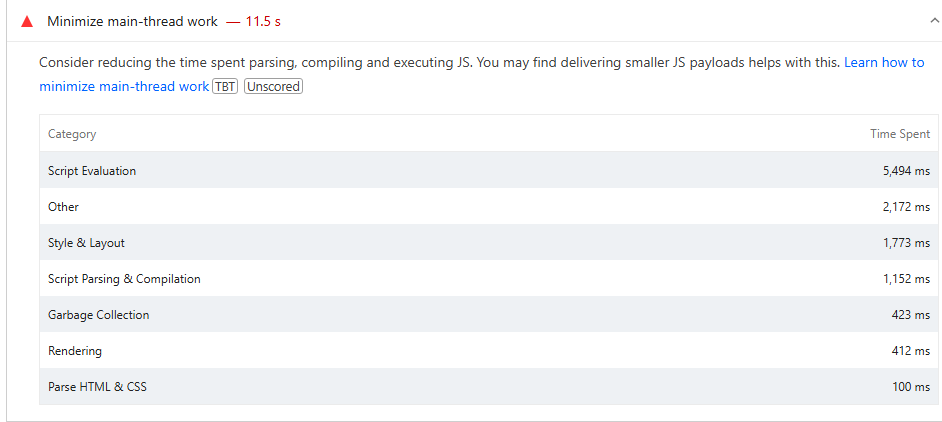
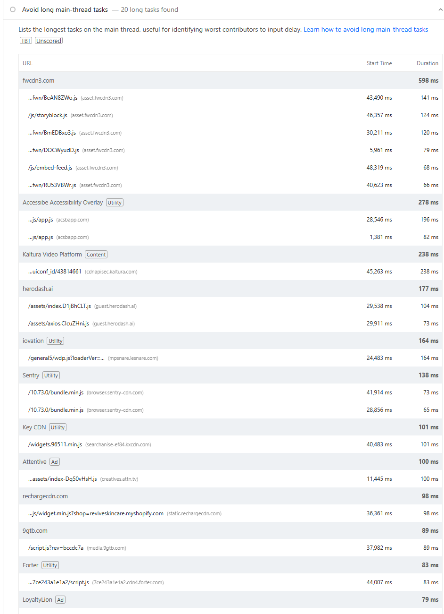

## 4.6 图片交付：节省 1,448 KiB

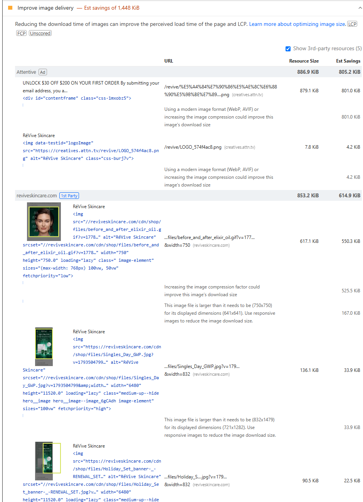

| 图片 | 问题 | 修复 |
| --- | --- | --- |
| Attentive 弹窗 PNG（879 KiB） | 第三方素材，使用 PNG，可节省 801 KiB | 在 Attentive 后台重新上传压缩后的 JPG/WebP（通常 < 100 KiB） |
| `before_and_after_elixir_oil.gif`（617 KiB） | GIF 动图；750 px 显示 641 px | **GIF 改为 MP4/WebM 视频**（`autoplay muted loop playsinline`），通常可缩小 80–90% |
| `Singles_Day_GWP.jpg` | 原图 6480×11520；同时写了 `loading="lazy"` **和** `fetchpriority="high"` | 互相矛盾的属性：这是第二张幻灯片还是首屏？首屏则 eager+high，否则 lazy+不加 high |
| `Holiday_Set_banner-_-RENEWAL_SET.jpg` | 原图 6480×11520，请求 832 宽而显示 721 宽 | 校正 `sizes`；上传前把原图缩到 ≤ 2400 px |

> 关于“原图 6480×11520”：Shopify CDN 会按 `width` 参数缩放，所以用户不会直接下载原图，但超大原图会让 CDN 首次转码更慢，也容易在某个 section 漏写 `width` 时直接输出巨图。上传规范建议：长边 ≤ 2400–3000 px。

## 4.7 其它项

| 条目 | 截图 | 说明 |
| --- | --- | --- |
| Duplicated JavaScript | [查看](../images/revive/revive-mobile-a-duplicated-javascript-insight.png) | 检查是否有同一个库被多个脚本重复打包 |
| Legacy JavaScript | [查看](../images/revive/revive-mobile-a-legacy-javascript-insight.png) | 第三方脚本中的 polyfill |
| Reduce unused JavaScript | [查看](../images/revive/revive-mobile-a-unused-javascript.png) | Firework、Kaltura 等首屏用不到的代码 |
| Font display | [查看](../images/revive/revive-mobile-a-font-display-insight.png) | 检查哪些 `@font-face` 缺少 `font-display` |
| Use efficient cache lifetimes | [查看](../images/revive/revive-mobile-a-cache-insight.png) | 第三方资源缓存短 |
| Forced reflow | [查看](../images/revive/revive-mobile-a-forced-reflow-insight.png) | 与 INP 相关，结合交互录制排查 |
| DOM size | [查看](../images/revive/revive-mobile-a-dom-size-insight.png) | 对照 TORRAS 的 6,744 个节点看 |
| Layout shift culprits | [查看](../images/revive/revive-mobile-a-cls-culprits-insight.png) | CLS 已达标 |

## 4.8 ReVive 的优化路线图

| 优先级 | 动作 | 影响指标 | 难度 |
| --- | --- | --- | --- |
| P0 | 移动端 Hero 视频降码率（≤ 1 MB）、`preload="none"`、在 `load` 后再加载；只加载当前断点的视频 | LCP、SI、总体积 | 低–中 |
| P0 | Sentry 换精简包 / 关闭 Replay / 延迟加载 | TBT、INP | 低（改配置） |
| P1 | Firework、Kaltura、Yotpo 进入视口再加载；评估两个视频平台只留一个 | TBT、LCP | 中 |
| P1 | `theme-customizations.css` 合并/拆分，`country-flags.css` 异步，关键 CSS 内联 | LCP（render delay）、FCP | 中 |
| P1 | GIF → MP4；Attentive 素材压缩；修正矛盾的 lazy/high 属性 | 总体积、LCP | 低 |
| P2 | preconnect 减到 ≤ 2 个；Yotpo 字体移出关键路径；字体字重精简 | LCP | 低 |
| P2 | accessiBe、Forter、Attentive、herodash 错峰延迟加载 | TBT、INP | 低–中 |

**预期：** 完成 P0 后，Lab 的 LCP 和 SI 应大幅下降（视频是体积和带宽竞争的最大来源），TBT 下降约 Sentry 对应的部分；Field 的 INP 留出更大安全余量。

## 4.9 两个案例的对比总结

| | TORRAS | ReVive |
| --- | --- | --- |
| Field CWV | 移动端 **Failed**（INP） | Passed |
| Lab 分（移动/桌面） | 69 / 93 | 45 / 44 |
| 最大问题 | **HTML 太大**（4.9 MB，App 内联配置 + 巨型 section） | **首屏之后加载太多**（视频 + 重型第三方 JS） |
| LCP 瓶颈 | Resource load delay（HTML 字节挡在图片前面 + 优先级稀释） | Resource load delay（视频抢带宽）+ Render delay（阻塞 CSS） |
| 交互瓶颈 | 大 DOM + 交互时集中加载的 App | Sentry、Firework 等脚本的 CPU 时间 |
| 第一步该做 | 去掉 Globo 的 2 MB 内联配置 | 移动端 Hero 视频降码率并延后加载 |

**同样是“LCP 慢”，两个站点的根因完全不同。** 这就是为什么必须按 [第 2 章](02-diagnosis-workflow.md) 的流程逐层下钻，而不是照搬“优化清单”。

## 附录：更多截图

| 截图 | 说明 |
| --- | --- |
| [移动端 Insights 列表](../images/revive/revive-mobile-03-insights.png) | 移动端全部 Insights |
| [桌面端 Field](../images/revive/revive-desktop-01-field.png) | 桌面端 CWV Passed（LCP 1.9 s / INP 129 ms / CLS 0.03） |
| [桌面端 Insights](../images/revive/revive-desktop-03-insights.png) | 桌面端 Insights 列表 |
| [桌面端 LCP breakdown](../images/revive/revive-desktop-a-lcp-breakdown-insight.png) | 桌面端 LCP 阶段 |
| [桌面端 JS 执行时间](../images/revive/revive-desktop-a-bootup-time.png) | 桌面端 bootup-time |
| [桌面端 3rd parties](../images/revive/revive-desktop-a-third-parties-insight.png) | 桌面端第三方 |
